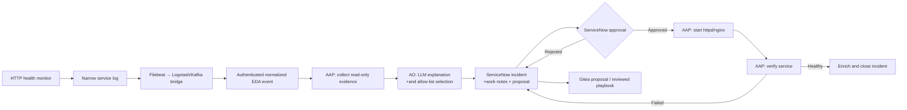

# ServiceNow-approved AI HTTP recovery demo

This optional scenario demonstrates a **controlled** recovery loop for one
Fleet host and one supported HTTP service (`httpd` or `nginx`). It is a demo
foundation, not an unattended production remediation system.

It deliberately separates observation, analysis, approval, remediation, and
verification. An LLM may explain evidence and select from the reviewed
allow-list; it must never author and execute arbitrary shell or Ansible code.

## What the scenario demonstrates



The initial event must contain only a normalized outage fact, service name,
Fleet host name, timestamp, and correlation ID. It must not contain passwords,
tokens, raw logs, arbitrary playbook text, or ServiceNow credentials.

## Safety contract

- The only packaged host change is idempotently starting `httpd` or `nginx`.
- An approval must be present in the ServiceNow-to-AO handoff before the AAP
  recovery template accepts `remediation_approved: true`.
- The AO workflow must use a per-correlation-ID lock, deduplicate one open
  incident, and stop after `max_remediation_attempts` (default: `2`). A failed
  or rejected proposal creates a new *proposal* and returns to human review;
  it must not retry indefinitely.
- The LLM produces an explanation, likely root cause, confidence, evidence
  citations, and a selected allow-listed action. Treat it as advisory. A low
  confidence result, unsupported service, missing evidence, or a proposed
  action outside the allow-list routes to a human-only ticket update.
- A recovery is successful only after AAP verification. The ticket is enriched
  and closed only on that verified result. Failed verification appends a
  redacted failure summary and leaves the incident open.
- TLS verification is mandatory for ServiceNow, Gitea, AAP, and EDA. Never use
  `validate_certs: false`, `GIT_SSL_NO_VERIFY`, or insecure webhook bypasses.

## Prepare the local scenario package

The prepare command checks only that local AAP and EDA are ready. It does not
create an incident, configure ServiceNow, push to Gitea, start an activation,
invoke a model, launch a workflow, or touch a Fleet host.

```bash
aap-demo enable ao
aap-demo enable fleet
aap-demo enable gitea
aap-demo enable eda
SERVICENOW_AI_DEMO_PREPARE=true aap-demo enable servicenow-ai-remediation
```

Copy this directory to an **owned private Gitea repository** before importing
it into AAP. Protect `main`; proposed playbooks use a branch and pull request,
and a human reviews/merges them. Do not grant the model or its AO service
account direct push permission to the protected branch.

## Build and register the execution and decision environment

Build only in an approved build system, scan/sign the resulting image, and push
it to the customer registry. Pin the reviewed base image and final image by
digest before import. The definition is in `execution-environment/`:

```bash
cd addons/servicenow-ai-remediation/execution-environment
ansible-builder build --tag registry.example.invalid/aap-demo/snow-remediation-ee:review
```

Before a production-like trial, replace the base image in
`execution-environment.yml` with the customer-approved AAP 2.7 supported EE
image and pin it by digest. The requirements add `ansible.eda`,
`ansible.controller`, and `servicenow.itsm`; record the exact resolved versions
and image digest in the Gitea pull request.

In AAP 2.7, register that same signed image in both places:

1. **Automation Execution Environments** as `aap-demo ServiceNow Recovery EE`;
   assign it to the evidence, incident, and recovery job templates.
2. **Automation Decisions → Decision Environments** as
   `aap-demo ServiceNow Recovery DE`; select it for the HTTP-outage rulebook
   activation.

Attach a controller credential to the Decision Environment so EDA can launch
only the named AAP analysis template. Use a separate AAP custom credential for
ServiceNow. Do not place ServiceNow credentials in the EDA event, an AO node,
survey field, Gitea variable, or command line.

## Credential layout

On first real configuration, prompt only for missing values and save them in
the encrypted Vault at `~/.ansible/conf/env.yml`:

```yaml
aap_demo:
  servicenow:
    instance_url: https://customer.service-now.com
    username: automation-service-account
    password: <encrypted>
```

Create an AAP custom credential that injects `SNOW_INSTANCE_URL`,
`SNOW_USERNAME`, and `SNOW_PASSWORD` into the incident playbooks. The ServiceNow
account needs only the incident fields and states approved by the customer; use
a dedicated service identity, scoped role, rotation policy, and an outbound
allow-list. Reconfigure credentials only with an explicit `--reconfigure` or
after a zero reset; normal re-runs reuse existing Vault values.

## Configure the workflow in this order

1. Create a private Gitea project from this package; create AAP templates for
   `collect_httpd_evidence.yml`, `create_servicenow_incident.yml`,
   `update_servicenow_incident.yml`, and `remediate_httpd.yml`. Bind the Fleet
   inventory and Fleet SSH credential only to the two host-targeting templates.
   Require an AAP job `limit` equal to `host_name`; both playbooks also refuse
   to act unless `inventory_hostname == host_name`.
2. Import the signed execution environment and Decision Environment described
   above. Create an EDA project from the Gitea repository and select
   `extensions/eda/rulebooks/httpd_outage.yml` for the activation.
3. Configure a ServiceNow integration in AO using the dedicated credential.
   Reuse the upstream `SNOW - Auto Remediation` and `Incidents | Update Ticket`
   templates imported by the `ao` addon only after mapping them to the reviewed
   Gitea templates and current AO API schema.
4. Create an AO workflow: collect evidence → LLM advisory/allow-list selection
   → create/enrich incident → wait for approved/rejected decision → recovery
   → verify → update/close. Add alternate branches for rejected, unsupported,
   low-confidence, and failed verification results.
5. Configure the Filebeat bridge. Filebeat ships the narrow monitor log to a
   customer-managed Logstash or Kafka bridge; that bridge validates the record
   and posts the normalized authenticated event to EDA. Filebeat does not itself
   serve as an arbitrary EDA HTTP webhook client. See
   `filebeat/filebeat.yml.example` for the deliberately minimal input.
6. Test first with a disposable Fleet node and a non-production ServiceNow
   development instance. Stop after the maximum attempt count and review the
   ticket, AO run, AAP job output, EDA activation history, and Gitea proposal.

## Required event shape

```json
{
  "event_type": "aap_demo.http_service_outage",
  "host_name": "aap-fleet-node-1",
  "service_name": "httpd",
  "correlation_id": "demo-2026-11-27-001",
  "observed_at": "2026-11-27T12:00:00Z"
}
```

The event is accepted only for `httpd` or `nginx`; the rulebook launches the
analysis template, not remediation. The approved recovery playbook repeats the
allow-list and approval checks, so an untrusted event cannot convert directly
into a service restart.
