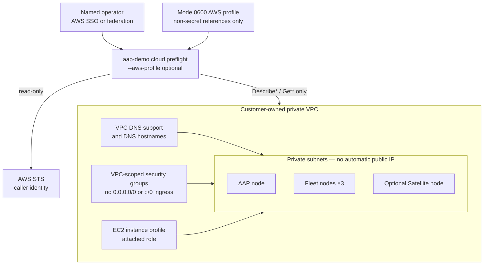
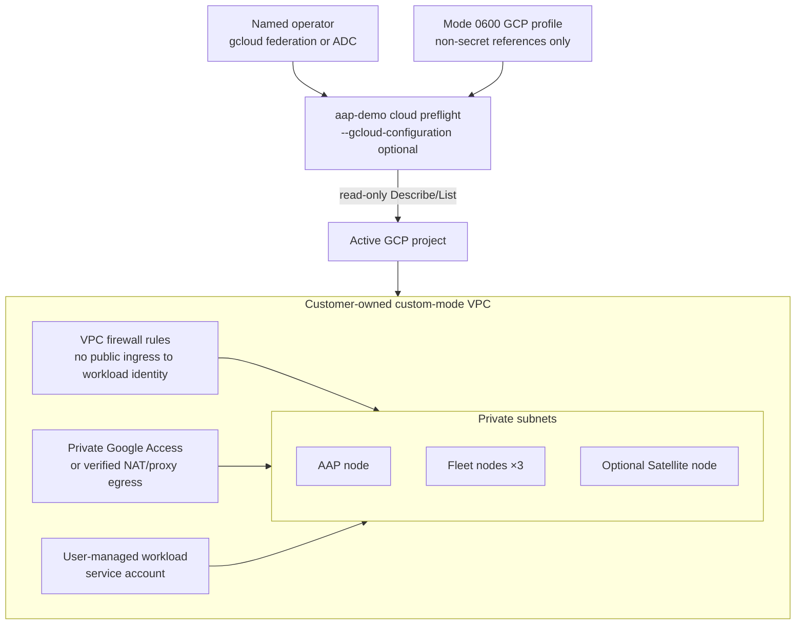
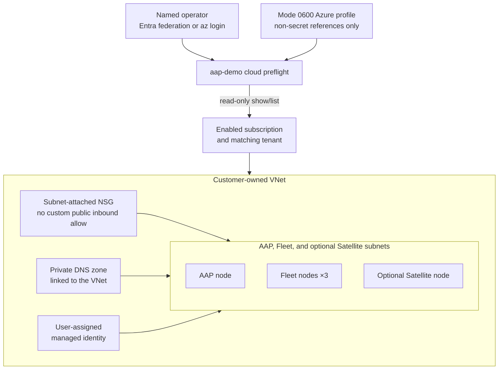
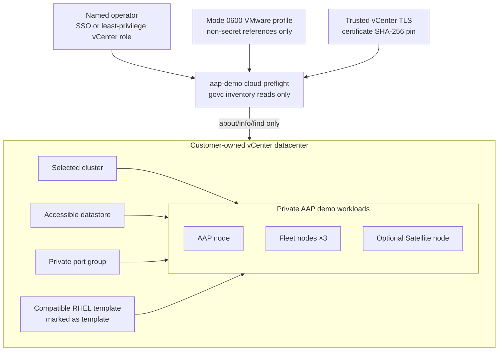

# Cloud and VMware planning profiles

Cloud profiles are a safe preparation step for a future aap-demo environment on
AWS, Azure, Google Cloud, or VMware vSphere. They are not a provider installer.
Profile commands do not authenticate to a cloud account, call a provider API,
create a machine, spend money, or change the current local lab. The explicit
The explicit provider preflights are the exception: they authenticate through
an already configured provider CLI and perform only read-only discovery.

Use one profile per customer environment. Keep it outside the repository and
review it with the customer network, identity, and cost owners before any future
provider adapter is approved.

```bash
mkdir -p ~/.config/aap-demo/cloud
aap-demo cloud requirements aws
aap-demo cloud profile init aws ~/.config/aap-demo/cloud/customer-lab.json
aap-demo cloud profile validate ~/.config/aap-demo/cloud/customer-lab.json
aap-demo cloud plan ~/.config/aap-demo/cloud/customer-lab.json
# Optional: query an approved AWS account with read-only permissions.
aap-demo cloud preflight ~/.config/aap-demo/cloud/customer-lab.json --aws-profile customer-sso
# Optional: query an approved GCP project with read-only permissions.
aap-demo cloud preflight ~/.config/aap-demo/cloud/customer-gcp.json --gcloud-configuration customer-sso
# Optional: query an approved Azure subscription with read-only permissions.
aap-demo cloud preflight ~/.config/aap-demo/cloud/customer-azure.json
# Optional: query an approved VMware vCenter with externally supplied govc access.
aap-demo cloud preflight ~/.config/aap-demo/cloud/customer-vmware.json
```

`init` creates the file mode `0600`. It deliberately contains `REPLACE_ME`
markers. `validate` reports every unresolved requirement and rejects a plaintext
secret-like field. `plan` performs the same validation and only states that the
profile is ready for later review; it does not have an apply mode.

## What a profile records

The profile is versioned JSON. It records identifiers and non-secret references,
not passwords, API keys, private keys, bearer tokens, or client secrets.

| Area | Needed before a future provisioner can run | Stored as |
| --- | --- | --- |
| Ownership | Customer ID, named operator, approval contact, cost center | Non-secret profile fields |
| Location | Region and availability zone, or VMware cluster | Non-secret profile fields |
| Network | Private DNS zone, management CIDRs, separate AAP/Fleet/Satellite subnets | Non-secret profile fields |
| Node plan | One AAP node, three Fleet nodes, optional Satellite node, disk and memory estimates | Non-secret profile fields |
| Operator access | SSO/federation, CLI login, or vCenter role reference | `external:` identity reference |
| Workload access | Instance profile, managed identity, service account, or vCenter role reference | `external:` identity reference |
| Red Hat access | Entitlement/customer-account reference | `aap_demo.*` Vault-key reference |
| Approval | Network, retention, and chargeable-resource approval | Explicit `true` fields |

The generated node sizes are planning estimates for the current demonstration
shape. They are neither a cost quote nor a promise that a particular image,
instance type, nested-virtualization setting, or OpenShift runtime is supported.
The profile must be validated against the selected provider, image, AAP version,
and Red Hat support policy before a provider adapter is enabled.

## AWS read-only preflight topology



The AWS adapter checks this contract only after profile validation. It calls STS,
EC2 `Describe*`, and IAM `GetInstanceProfile`; it does not create, modify, start,
or delete a resource. A failure reports the missing or unsafe prerequisite and
leaves the account unchanged.

The preflight identity needs only the following discovery actions for the
currently implemented checks: `sts:GetCallerIdentity`, `ec2:DescribeVpcs`,
`ec2:DescribeVpcAttribute`, `ec2:DescribeSubnets`,
`ec2:DescribeSecurityGroups`, and `iam:GetInstanceProfile`. It uses the AWS CLI
login already on the operator workstation (or `--aws-profile NAME`) and does
not collect an AWS access key or write a cloud credential into the Vault.

## GCP read-only preflight topology



The GCP adapter checks the active project, custom-mode VPC, selected subnets,
firewall exposure, and workload service account. It uses `gcloud projects
describe`, `gcloud compute networks describe`, `gcloud compute networks
subnets describe`, `gcloud compute firewall-rules list`, and `gcloud iam
service-accounts describe`. It does not create, update, start, stop, or delete
a GCP resource. A subnet without Private Google Access is a warning, not an
automatic change: the customer must instead demonstrate approved NAT or proxy
egress before any future apply.

The preflight caller needs read access to the named project, VPC, subnet,
firewall rules, and service account. It uses the selected local gcloud
configuration (or `--gcloud-configuration NAME`) and does not collect a
service-account key or write a GCP credential into the Vault.

## Azure read-only preflight topology



The Azure adapter checks the signed-in tenant and subscription, resource group,
VNet, selected subnet-to-NSG associations, custom NSG inbound rules, private
DNS zone/VNet link, and user-assigned managed identity. It uses only `az ...
show` and `az network private-dns link vnet list`; it does not create, update,
start, stop, or delete an Azure resource. The caller needs read access to those
named resources. It does not collect a client secret or write an Azure
credential into the Vault.

## VMware read-only preflight topology



The VMware adapter requires the `govc` CLI and an externally supplied
`GOVC_URL` for the profile's vCenter. It rejects `GOVC_INSECURE=true`, requires
that the hostname matches `provider_config.vcenter_url`, retrieves the
certificate's SHA-256 fingerprint, and refuses discovery if it differs from
`provider_config.certificate_sha256`. `govc` must separately trust the vCenter
certificate through the system trust store, `GOVC_TLS_CA_CERTS`, or
`GOVC_TLS_KNOWN_HOSTS`.

After TLS pinning, the adapter uses only `govc about`, `datacenter.info`,
`cluster.info`, `datastore.info`, `find`, and `vm.info`. It checks the named
datacenter, cluster, accessible datastore, port group, and a VM that is marked
as a template. It does not clone, create, reconfigure, power on, or delete a
VM or any other vSphere object. `govc` documents `GOVC_URL`, TLS-CA, TLS-known
hosts, and its `-k` insecure switch; this preflight deliberately refuses that
switch. [See the official govc usage reference](https://github.com/vmware/govmomi/blob/main/govc/usage.sh).

Use an external credential mechanism to provide `GOVC_URL`; never put a
password in the profile. A future apply adapter may retrieve an exceptional
non-federated vCenter secret from the encrypted Ansible Vault at
`~/.ansible/conf/env.yml`, but it must expose only an `external:` reference in
the profile and never display the value.

## Required private connectivity

The future adapter must calculate provider-specific ports from enabled features;
it must not open broad inbound rules. The minimum flow model is:

| Source | Destination | Purpose | Control |
| --- | --- | --- | --- |
| Named operator or approved bastion | AAP, Satellite, and managed nodes | Administration | Private VPN/peering or equivalent; named source CIDRs/identities only |
| AAP execution environment | Fleet nodes | Automation transport | Private subnet path and verified SSH host keys |
| Satellite (when selected) | Fleet nodes | Registration and content | Private DNS, TLS, and the exact Satellite registration/content flows |
| Managed nodes | Red Hat, registries, provider control plane | Entitlement, images, and supported APIs | Egress allow-list/proxy where required; verified TLS |
| Browser user | Dashboard | Local management view | Localhost by default; never make it a public management endpoint |

Do not place a public IP on an AAP, Fleet, Satellite, or dashboard management
interface merely to simplify a demo. The profile records `management_cidrs` so a
future adapter can reject `0.0.0.0/0`, `::/0`, missing private DNS, or overlapping
subnets before it creates anything.

## Provider-specific inputs

`aap-demo cloud requirements PROVIDER` prints the short checklist. The profile
validator enforces the corresponding fields.

| Provider | Required provider inputs | Preferred identity model |
| --- | --- | --- |
| AWS | Account, region/AZ, VPC, private subnets, security groups, EC2 instance profile | Federation/IAM Identity Center for the operator; least-privilege IAM role and instance profile for workloads |
| Azure | Tenant, subscription, resource group, region, VNet/subnets, network security group, managed identity | Entra federation/Azure CLI for the operator; managed identity for workloads |
| GCP | Project, region/zone, VPC/subnets, firewall-policy reference, user-managed service account | Workforce federation or application-default credentials for the operator; attached user-managed service account for workloads |
| VMware | vCenter URL and certificate SHA-256 fingerprint, datacenter, cluster, datastore, port group, compatible template | Federated or least-privilege vCenter role; certificate pinning before first connection |

AWS EC2 instance roles provide temporary credentials through instance profiles;
they avoid distributing a long-lived credential to every VM. [AWS documents the
model and least-privilege guidance](https://docs.aws.amazon.com/AWSEC2/latest/UserGuide/iam-roles-for-amazon-ec2.html).
Google Cloud recommends user-managed service accounts for VM workloads, and its
VPC rules can target service accounts rather than broad networks. [See the
Compute Engine service-account guidance](https://cloud.google.com/compute/docs/access/service-accounts)
and [VPC firewall overview](https://cloud.google.com/compute/docs/networking/network-overview).
Azure NSGs can be scoped to subnets or NICs and need explicit inbound and
outbound rules. [See Azure's network overview](https://learn.microsoft.com/en-us/azure/virtual-machines/network-overview).

## Credentials and prompts

The cloud profile intentionally cannot store credentials. It accepts only a
reference beginning with `external:` or `aap_demo.`. This prevents accidental
secrets in Git, shell history, process lists, ordinary configuration, and the
dashboard.

Current aap-demo credentials remain in the encrypted Ansible Vault at
`~/.ansible/conf/env.yml`; see [Credential Vault](credential-vault.md). A future
provider adapter may add a narrowly scoped Vault entry only when the provider
cannot use federation or workload identity. It must use the `aap_demo.cloud`
namespace, record only a reference in the profile, prompt on a TTY, and never
print the value. It must not ask again after successful setup unless the user
explicitly requests `--reconfigure` or resets the owned environment.

Before a future `apply`, the user-facing prompt flow must ask only for missing
non-secret values, in this order:

1. Choose provider and existing private account/project/subscription/vCenter
   location.
2. Confirm customer ownership, named approver, cost center, and retention.
3. Select existing private network, subnets, DNS, and approved management
   sources; display the exact proposed flow rules.
4. Select images/templates, AAP/Fleet/Satellite topology, and explicit capacity
   estimates.
5. Select federated operator and workload identities, or explicitly confirm the
   exceptional Vault-backed secret path.
6. Preview every chargeable resource and provider operation, then require a
   separate affirmative apply confirmation.

## Current boundary and next implementation slice

This foundation is intentionally compatible with the existing local lab but does
not run it inside a cloud VM. CRC nested virtualization, a Satellite deployment,
external DNS, Red Hat entitlement, OpenShift licensing, provider quotas, and
backup/restore must each be qualified for the selected provider and image.

AWS identity, VPC, DNS, subnet, security-group, and instance-profile discovery
is implemented. GCP project, custom-VPC, subnet, firewall, and service-account
discovery is implemented. Azure tenant/subscription, VNet/subnet, NSG, private
DNS, and managed-identity discovery is implemented. VMware vCenter TLS and
named-inventory discovery is implemented. Quota, image, capacity, and Red Hat
entitlement discovery remain unimplemented for all providers. Only after
provider-specific evidence exists should a separate adapter offer a reviewed,
explicitly approved `apply`, lifecycle controls, dashboard status, and teardown
behavior.
